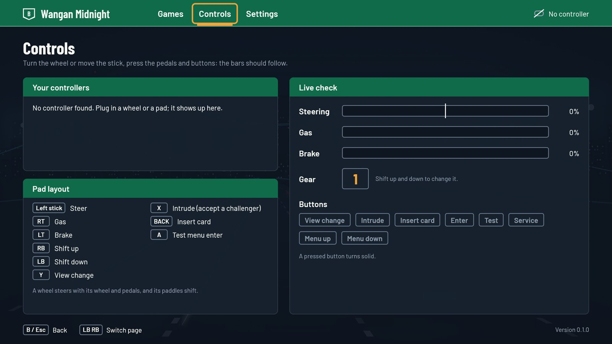
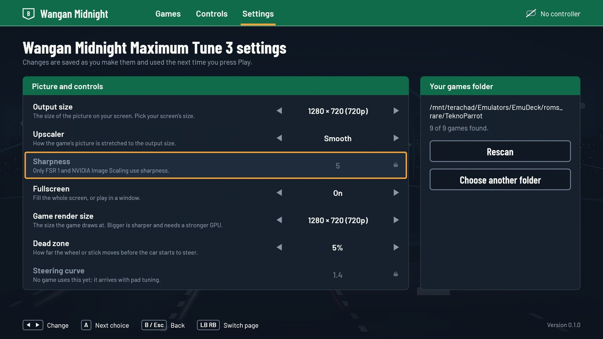
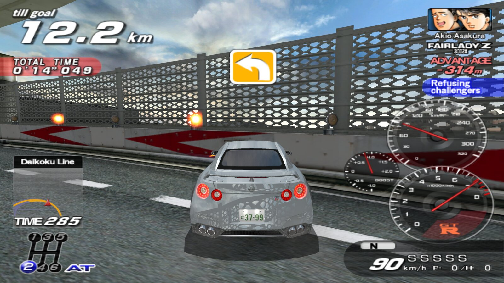

# Wangan Midnight launcher

One launcher for the Wangan Midnight arcade series: Wangan Midnight R,
Maximum Tune 3, 3DX+, 5, 5DX+, 6, 6R and 6RR (Maximum Tune 1 is listed but
can't start yet). Point it at the folder with your own game dumps and it
finds each game, sets it up and runs it full screen with your pad or wheel.
Your game folders are only read, never changed: each game runs from a
private folder that links to your dump.

This project contains no game files and downloads none: you need your own
dumps (and, for Wangan R and Maximum Tune 1, the board files from the
original hardware).

> **Work in progress.** Every game but Maximum Tune 1 plays races through
> the launcher on Linux; the Windows build was played under Wine, not yet
> on a Windows PC. Wheels and force feedback aren't tested on hardware yet
> ([docs/RUNTIME_NOTES.md](docs/RUNTIME_NOTES.md)). Reports are welcome at
> <https://github.com/akitaonrails/rea-teknoparrot-wangan-series/issues>.

## Problems this launcher solves

TeknoParrot is the usual way to play these dumps on a PC. This is what a
player runs into, especially on Linux, and what the launcher does about it
(the research is in [docs/RESEARCH.md](docs/RESEARCH.md)).

| Problem | What the launcher does |
| --- | --- |
| TeknoParrotUI is a Windows .NET program; its Linux build has no game loaders. | One native window finds every game in your folders and starts each with an open loader. |
| For Maximum Tune 5-6RR the UI is the cabinet's I/O board: closing it leaves the game without a wheel. | Its own I/O board, `wangan-io`, answers the Namco JVS protocol (ported from TeknoParrotUI's GPL source), fed by the launcher. No TeknoParrot UI, no .NET. |
| The 6/6RR loader is closed, and 6RR's saving needs a subscription. | OpenParrot and OpenParrot_WMMT, built from source with this project's fixes. |
| Under Wine the 5/6 series crash on their first intro movie. | The launcher's Wine prefix gets the two settings that let the decoder output what the game asks for. |
| Maximum Tune 6 crashes right after the card prompt under Wine. | A small OpenParrot patch zeroes the thread field only Wine reads. |
| 6RR stops at its boot checks (a steering board and a card unit), then shows E0551. | It gets first-boot settings without them, plus 6R's terminal-wait skip. |
| MT3/3DX+ are Linux programs that lost their library links and execute bit. | They run natively in WanganArcadeLoader (patched); the links are rebuilt inside the private runtime, never in your dump. |
| Controls are set up per game, by device. | One input path for every game: pads and wheels through SDL, analog steering and pedals, sequential shifting on shoulder buttons or paddles. |
| Wangan R and Maximum Tune need firmware that isn't in the dumps. | **Add files** looks through a folder or zip you name and keeps only the files whose size and SHA-1 match MAME's records. |

## Screenshots

| Games | Controls | Settings |
| --- | --- | --- |
|  |  |  |

| | |
|---|---|
|  |  |
| Maximum Tune 3DX+, drawn at 3840×2160 (native Linux) | Maximum Tune 5DX+ |
|  |  |
| Maximum Tune 6 | Maximum Tune 6RR |

## What you need

- Your own dumps of the games, one folder each, as the community shares
  them. Only the exact builds the launcher knows are started (each is
  identified by the SHA-256 of its main file); another build is listed
  with its digest so you can report it.

  | Game | Board | How it runs | Linux | Windows |
  |---|---|---|---|---|
  | Maximum Tune 3 (Export) | Namco N2 | natively, WanganArcadeLoader (patched) | plays, up to 4K | no (a Linux game) |
  | Maximum Tune 3DX+ (Export) | Namco N2 | same | plays, up to 4K | no (a Linux game) |
  | Maximum Tune 5 (5.00, Japan) | Namco ES3B | OpenParrot + the launcher's I/O board | plays | not yet run |
  | Maximum Tune 5DX+ (Export) | Namco ES3B | same | plays | played under Wine |
  | Maximum Tune 6 (1.03.04, Export) | Namco ES3B | same, with this project's OpenParrot fixes | plays | played under Wine |
  | Maximum Tune 6R (Japan) | Namco ES3B | same | plays | not yet run |
  | Maximum Tune 6RR (3.05.03, Japan) | Namco ES3B | OpenParrot_WMMT (patched) + the I/O board | plays (on credits) | not yet run |
  | Maximum Tune (3.07 Rev B) | Sega Chihiro | TeknoParrot's Cxbx-Reloaded under Wine; needs the four Chihiro media-board files | not yet: freezes in most runs | not yet run |
  | Wangan Midnight R | Namco System 246 | pcsx2x6 (bundled); needs the System 246 BIOS | plays, up to 4K | not yet |

- **Linux**: gamescope, a Vulkan driver, 32-bit OpenGL for MT3/3DX+ (Arch:
  `lib32-nvidia-utils` or `lib32-mesa`; Debian/Ubuntu: `libgl1:i386`), and
  GStreamer's libav plugin for the intro movies (Arch: `gst-libav`;
  Debian/Ubuntu: `gstreamer1.0-libav`). bubblewrap, when installed, keeps
  your game folders read-only while a game runs. Wine, DXVK, the loaders,
  pcsx2x6 and SDL2 come with the package.
- **Windows**: Windows 10 or 11.
- A pad or a wheel. The keyboard works for menus.

The community loaders answer the cabinets' HASP dongle and card reader;
the launcher itself doesn't remove or patch any protection, and can't help
you get the games.

## Download and install

1. Download the Linux `.tar.gz` or the Windows `.zip` from
   [Releases](https://github.com/akitaonrails/rea-teknoparrot-wangan-series/releases).
2. Unpack it anywhere.
3. Run `./wangan-launcher` (Linux) or `wangan-launcher.exe` (Windows).

## First run

The first window asks for the folder that holds your game folders. Type its
path and press **Add folder** (add more folders if your games are spread
out), then **Done**. The first start of a Maximum Tune 5/6 game creates the
Wine prefix and takes a minute.

For Wangan Midnight R (and Maximum Tune 1), select the game and press
**Add files**: type the folder or zip where you keep the board files. The
launcher looks inside (zips and subfolders too), keeps only exact matches
whatever their names, and copies them to its own folder. It never
downloads them. `wangan-launcher --add-files <folder>` does the same.

## The settings window

- **Games**: a tile per game, its picture, edition, folder and state, and
  **Play** (or **Add files**). A game that can't start yet says why.
- **Controls**: the wheels and pads the launcher sees, which one drives the
  car, the pad layout, and a live check of steering, pedals and buttons.
- **Settings**: the selected game's options, saved as you change them,
  plus your game folders.

Everything works with a mouse, the keyboard or a pad: the d-pad or left
stick moves (holding it repeats), A chooses, B goes back, Start plays, Y
opens Settings, the shoulder buttons change tabs. While a game runs the pad
belongs to the game, and the window offers **Stop**; closing the window
stops the game first. Options a game can't use here are shown greyed out
with the whole reason (on Windows: the look and gamescope's rows; for the
ES3B games and Wangan R: the render size).

## Gamepad

| Pad | Cabinet |
|---|---|
| Left stick | Steering |
| RT / LT | Gas / brake |
| RB / LB | Shift up / down |
| Y | View change |
| X | Intrude |
| Back | Insert card |
| Start | Insert coin (6RR plays on credits) |
| A | Test menu enter |

Wangan Midnight R runs in pcsx2x6, which reads the pad itself: left stick,
RT/LT, RB/LB and Y as above, Back inserts a coin, Start is Start, Escape
quits. Keyboard: arrows to drive, 5 coin, 1 Start, E/Q shift, V view. The
dead zone and wheel handling don't apply to it yet.

## Options

Each game keeps its own options. Every option is a line in that game's
settings file and a flag for `--play <game>` or `--set <game>`:

| Option | Flag | What it changes |
| --- | --- | --- |
| Look | `--look original\|recommended\|steam_deck` | The render size, output size and upscaler at once: the game's own, sharper for your screen, or for the Steam Deck (Linux) |
| Output size | `--output <WxH>` | The size of the picture on your screen (Linux) |
| Upscaler | `--upscaler fsr\|nis\|linear\|nearest` | How the picture is stretched to the output size (Linux) |
| Sharpness | `--sharpness 0-20` | FSR and NVIDIA Image Scaling sharpness, 0 is sharpest (Linux) |
| Fullscreen | `--fullscreen on\|off` | Full screen or a window (Linux) |
| Game render size | `--render <WxH>\|native` | The size MT3/3DX+ draw at (native: the output size) |
| Dead zone | `--deadzone 0.00-0.30` | How far a stick moves before the car steers |

Until you choose a picture, a game uses the Recommended look for your
screen (the Steam Deck look on a Deck), saved once the window (or, on
Windows, the command line) sees the screen; the Linux command line uses the
look for a 1920×1080 screen for that run only. `--look` followed by a
picture flag makes the picture custom. A flag a game doesn't take is
refused. Other commands: `--list` (what was found; works while the
window is open), `--check [<game>]` (what could start, without starting),
`--library <folder>`, `--add-files <path>`, `--help`. `--game <game>` is
`--set`'s old name.

## Where things live

| What | Linux | Windows |
|---|---|---|
| Settings, logs (`launcher.log`, `<game>.log`) | `~/.local/share/rea-wangan/` | `%LOCALAPPDATA%\rea-wangan\` |
| Each game's private folder, saves included | `rea-wangan/runtimes/<game>/` | same |
| The board files you added | `rea-wangan/firmware/` | same |
| Wine prefix | `rea-wangan/prefix/` | — |

## Troubleshooting

- **A game says it is not in your folders**: run `wangan-launcher --list`.
  An unknown build is listed with its SHA-256; please
  [report it](https://github.com/akitaonrails/rea-teknoparrot-wangan-series/issues/new?template=unknown-edition.yml).
- **A game stops right away**: the launcher says so, with the lines of the
  game's log that tell why; the whole log is `<game>.log` in the data
  folder, and every message is also in `launcher.log`.
- **Wangan R or Maximum Tune says it needs board files**: press **Add
  files** and point it at the folder or zip that has them; the page lists
  each file as In, Missing or Wrong file.
- Anything else: [open a bug report](https://github.com/akitaonrails/rea-teknoparrot-wangan-series/issues/new?template=bug-report.yml)
  with the game's log.

## Known limitations

- Maximum Tune 1 can't start: under Wine its Chihiro emulator freezes in
  most runs.
- FSR 1 / NIS upscaling and the output size are not verified on a real
  screen (gamescope can't use FSR in the headless display the tests run
  in).
- A physical wheel and force feedback are untested; there is no force
  feedback yet.
- Maximum Tune 6 saves are written and read back, but the game does not
  yet show restored progress. 6RR plays as a guest on credits.
- MT3/3DX+ run only in the Linux build; Wangan R has only been set up on
  Linux.

## Uninstall

Delete the launcher's folder, then `~/.local/share/rea-wangan/` (on Windows
`%LOCALAPPDATA%\rea-wangan\`). Copy `runtimes/` first if you want to keep
your card data and records.

## For developers

Rust workspace: `crates/wangan-core` (catalog, board files, runtime folder
rules, option table, launch plans; host-tested), `crates/wangan-launcher`
(the hub's backend, the command line, sessions, the input block),
`crates/wangan-jvs` (the JVS board, GPL port) and `crates/wangan-io` (the
board program). `AGENTS.md` has the checks and the layout.

```sh
cargo test --workspace
scripts/build-openparrot.sh   # OpenParrot with this project's patches
scripts/build-wal.sh          # WanganArcadeLoader with the input patch
scripts/build-launcher.sh linux
```

Releases are built by `.github/workflows/build.yml` from pinned sources.

## Built on rea-launcher-sdk

The hub window, the command line, the library scan, the runtime folder of
links, gamescope's command line, the game's process group and its run, the
SDL input thread, the option table, settings parsing, wheel and pad logic,
messages, single instance, packaging and CI come from
[rea-launcher-sdk](https://github.com/akitaonrails/rea-launcher-sdk) (its
TeknoParrot hub modules, shared with the Initial D, Nintendo and Sega
launchers), pinned by tag in `Cargo.toml` and vendored in `sdk/`. The game
catalog, the routes, the board files, the JVS board, the input block, the
Wine prefix fixes and the loader patches are this launcher's own.

## Contributing

- **About these games** (their editions, routes, settings, this README):
  issues and pull requests here.
- **Shared code** (the hub window, the option table, wheel and pad logic,
  packaging helpers, CI workflows, anything under `sdk/`): issues and pull
  requests at [rea-launcher-sdk](https://github.com/akitaonrails/rea-launcher-sdk/issues).
- Never patch `sdk/` or copy SDK code here: fix the SDK and bump the tag.
- Never attach game files or board files to an issue.

## Credits

Built on OpenParrot (teknogods), OpenParrot_WMMT (valkyrieasyraf),
OpenBanapass (ProjectAsakura), WanganArcadeLoader (vixen256), pcsx2x6 and
Proverb (PS2Homebrew-arcade), DXVK, Wine, SDL and the TeknoParrotUI source;
Barlow fonts (Jeremy Tribby, SIL OFL);
[rea-launcher-sdk](https://github.com/akitaonrails/rea-launcher-sdk). The
full list is in [THIRD_PARTY.md](THIRD_PARTY.md). Thanks to the Wangan
Midnight emulation community.

## Legal

Wangan Midnight Maximum Tune is a trademark of Bandai Namco Entertainment;
Wangan Midnight of its owners. This project is not affiliated with or
endorsed by them, TeknoParrot or any of the projects above. It contains no
game files and only runs dumps you own. Our code is GPL-3.0-or-later
([LICENSE](LICENSE)); bundled parts keep their licences
([THIRD_PARTY.md](THIRD_PARTY.md)).
