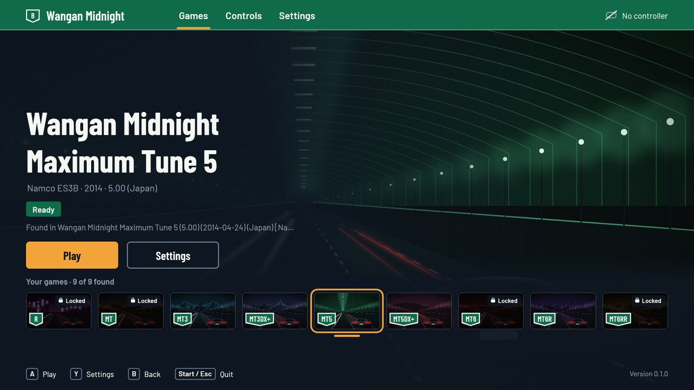
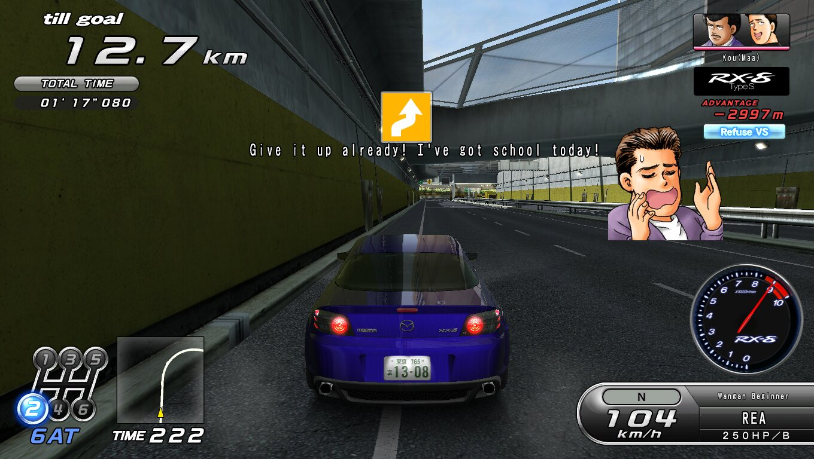
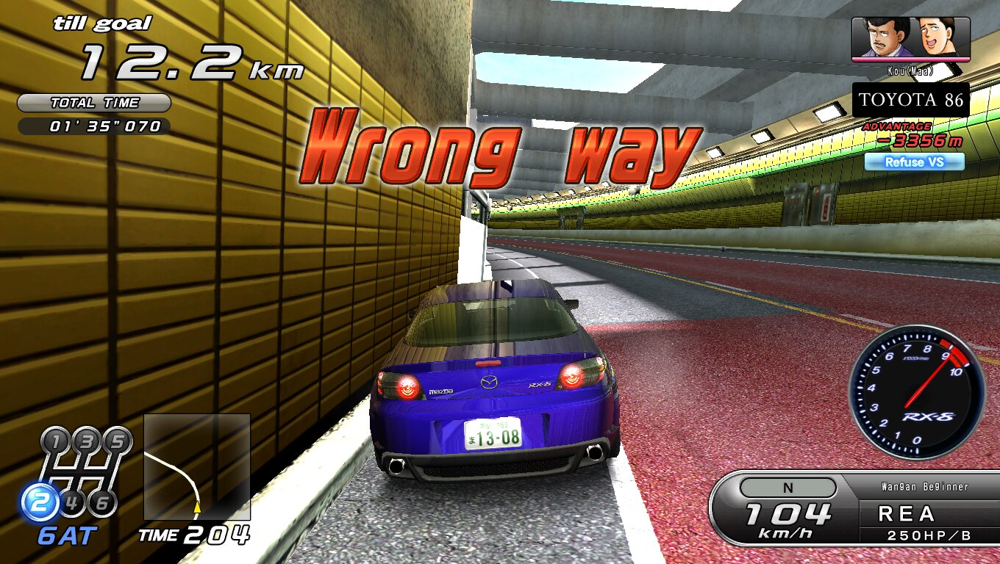
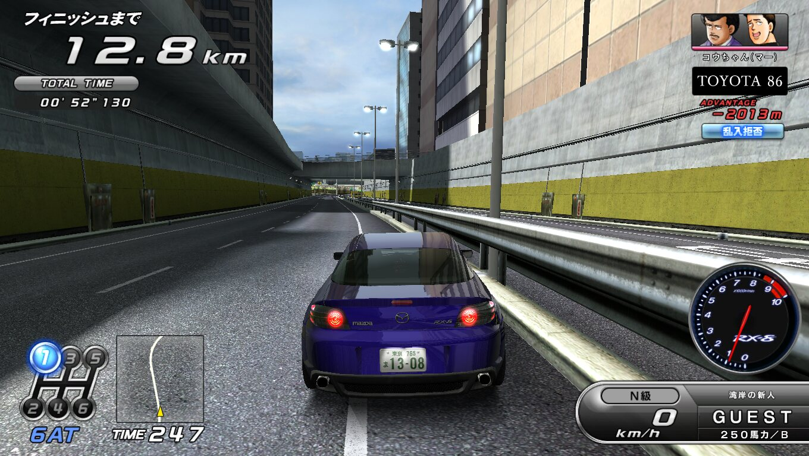

# Wangan Midnight launcher

One launcher for the Wangan Midnight arcade series. Point it at the folder
with your own game dumps and it finds each game, sets it up and runs it
full screen with your pad or wheel. Built on
[rea-launcher-sdk](https://github.com/akitaonrails/rea-launcher-sdk).



No game files are included or downloaded. The launcher never writes to
your games folder: each game runs from a private folder that links to
your dump.

| | |
|---|---|
|  |  |
| Maximum Tune 3DX+, drawn at 3840×2160 (native Linux) | Maximum Tune 5DX+ |
|  |  |
| Maximum Tune 6 | Maximum Tune 6RR |

A 1:1 crop of the 4K frame: [docs/images/mt3dxp-4k-detail.jpg](docs/images/mt3dxp-4k-detail.jpg).

## What runs

| Game | Board | How it runs | Linux | Windows |
|---|---|---|---|---|
| Maximum Tune 3 (Export) | Namco N2 | natively, with WanganArcadeLoader (patched) | plays | no (Linux game) |
| Maximum Tune 3DX+ (Export) | Namco N2 | same | plays, up to 4K | no (Linux game) |
| Maximum Tune 5 (5.00, Japan) | Namco ES3B | OpenParrot + this launcher's I/O board | plays | see release notes |
| Maximum Tune 5DX+ (Export) | Namco ES3B | same | plays | see release notes |
| Maximum Tune 6 (1.03.04, Export) | Namco ES3B | same, with this project's OpenParrot fixes | plays | see release notes |
| Maximum Tune 6R (Japan) | Namco ES3B | same | plays | see release notes |
| Maximum Tune 6RR (3.05.03, Japan) | Namco ES3B | OpenParrot_WMMT (patched) + the I/O board | plays (on credits) | see release notes |
| Maximum Tune (3.07 Rev B) | Sega Chihiro | needs four Chihiro media-board files you supply | waiting for files | waiting for files |
| Wangan Midnight R | Namco System 246 | needs a System 246 BIOS you supply | waiting for files | waiting for files |

"Plays" means a race was driven in the real game through the launcher,
with its own input path; each run is recorded in
[docs/RUNTIME_NOTES.md](docs/RUNTIME_NOTES.md). Only the exact builds
listed in the hub are started (each is identified by the SHA-256 of its
main file). Another build shows its digest so you can report it.

## Why not just TeknoParrot?

TeknoParrot is the usual way to play these dumps on a PC. This is what a
new player runs into, especially on Linux. Each point comes from setting
these games up for this project (see [docs/RESEARCH.md](docs/RESEARCH.md)).

- **The program is Windows and .NET.** TeknoParrotUI needs the .NET
  Framework; under Wine that means a dedicated prefix and winetricks. Its
  native Linux build ships without the game loaders, so no game starts
  from it.
- **The UI has to stay open while you play.** For Maximum Tune 5–6RR the UI
  is the cabinet's I/O board: it reads your controllers and answers the
  game's JVS packets over a named pipe. Without it the game has no wheel.
- **The core is closed.** The loader for the 6/6RR series is a closed
  binary that only runs from the UI, and 6RR's metadata says saving needs a
  subscription.
- **Wine trouble, game by game.** Under Wine the 5/6 series crash on their
  first intro movie (Media Foundation can't build the decoder the game
  asks for). Maximum Tune 6 crashes right after the card prompt. Older
  OpenParrot builds crash at start under Wine 11's new WoW64.
- **6RR stops at its boot checks** with the open loader: it waits forever
  for a force-feedback steering board and an IC-card unit that its
  first-boot defaults turn on, then shows E0551.
- **MT3/3DX+ are Linux programs.** TeknoParrot runs them through a Linux
  emulation layer on Windows, which on Linux means a Linux game through
  Windows through Wine. The dumps also lost their library symlinks and the
  game binary its execute bit; fixing that by hand changes your dump.
- **Controls are set up per game** in the UI, by device, and a pad's analog
  steering depends on that mapping.

## What this launcher does about it

- **Its own I/O board.** `wangan-io` answers the Namco JVS protocol the
  game expects (ported from TeknoParrotUI's GPL source), fed by the
  launcher. No TeknoParrot UI, no .NET.
- **Open loaders only:** OpenParrot and OpenParrot_WMMT for the ES3B games,
  built from source with this project's fixes; WanganArcadeLoader for the
  N2 games, natively on Linux.
- **Movies work under Wine:** the launcher's Wine prefix gets the two
  settings that let the decoder output what the game asks for.
- **Maximum Tune 6 fixed:** the game's coroutine code leaves a thread
  field uninitialised that only Wine reads; a small OpenParrot patch zeroes
  it.
- **6RR fixed:** it gets first-boot settings without the steering board
  and the card unit, plus the terminal-wait skip that 6R already had.
- **Your dump stays untouched.** Lost symlinks are rebuilt from each
  library's real name inside the private runtime; saves stay there too.
- **Clean exit.** Closing the game stops the game, then the I/O board, then
  Wine, so the cabinet never shows a board error and nothing keeps running.

## What it adds

- **One hub for the whole series**, with an original illustration per game,
  driven by pad, keyboard or mouse.
- **4K on MT3/3DX+**, drawn natively at up to 3840×2160 (above).
- **One input path for every game.** Pads and wheels are read with SDL:
  analog steering and pedals, a stick dead zone, sequential shifting on
  shoulder buttons or wheel paddles, wheels recognised from the SDK's
  table. The Controls page shows live steering, pedal, gear and button
  readings so you can check your setup before playing.
- **Screen options** through gamescope on Linux: output size and FSR 1 or
  NVIDIA Image Scaling (see "Not verified yet").
- **Every window option has a command-line flag**, for scripts and front
  ends like ES-DE.

## Install

### Linux

1. Download the Linux `.tar.gz` from
   [Releases](https://github.com/akitaonrails/rea-teknoparrot-wangan-series/releases)
   and unpack it anywhere.
2. Install from your distribution: **gamescope**, a **Vulkan** driver, and
   **32-bit OpenGL** for MT3/3DX+ (Arch: `lib32-nvidia-utils` or
   `lib32-mesa`; Debian/Ubuntu: `libgl1:i386`). Wine is bundled.
3. Run `./wangan-launcher` and choose the folder that holds your game
   folders. The first start of an MT5/MT6 game creates the Wine prefix and
   takes a minute.

### Windows

1. Download the Windows `.zip` from
   [Releases](https://github.com/akitaonrails/rea-teknoparrot-wangan-series/releases)
   and unpack it.
2. Run `wangan-launcher.exe` and choose your games folder. MT3/3DX+ are
   Linux programs: they are listed but can't start on Windows.

## Use

```sh
wangan-launcher                                  # the window
wangan-launcher --library /path/to/your/games    # remember the games folder
wangan-launcher --list                           # what was found
wangan-launcher --play mt5dxp                    # start one game
wangan-launcher --game mt3dxp --render 3840x2160 --output 3840x2160
```

`--help` lists every option.

| Pad | Cabinet |
|---|---|
| Left stick | Steering |
| RT / LT | Gas / brake |
| RB / LB | Shift up / down |
| Y | View change |
| X | Intrude |
| Back | Insert card |
| Start | Insert coin (6RR plays on credits) |
| A | Test menu enter |

## Where things are

| What | Linux | Windows |
|---|---|---|
| Settings, logs | `~/.local/share/rea-wangan/` | `%LOCALAPPDATA%\rea-wangan\` |
| Each game's private folder, saves included | `rea-wangan/runtimes/<game>/` | same |
| Wine prefix | `rea-wangan/prefix/` | — |

To remove everything, delete that folder. Back up `runtimes/` first: your
card data and records live there.

## Not verified yet

- FSR 1 / NIS upscaling and the output size on a real screen. gamescope
  can't use FSR in the headless display the tests run in.
- A physical wheel and force feedback. Steering, pedals and gears were
  driven through the same input path a wheel uses, but no wheel was
  attached during testing, and there is no force feedback yet.
- Frame pacing on a real 60 Hz display, and audio.
- Maximum Tune 6 saves are written and read back, but the game does not
  yet show restored progress.
- 6RR plays as a guest on credits; its network login (ALL.Net) is not
  emulated.

## Building

```sh
cargo test --workspace
scripts/build-openparrot.sh   # OpenParrot with this project's patches
scripts/build-wal.sh          # WanganArcadeLoader with the input patch
```

Releases are built by GitHub Actions from pinned sources; see
`.github/workflows/`.

## Credits and licence

GPL-3.0-or-later. Built on OpenParrot (teknogods), OpenParrot_WMMT
(valkyrieasyraf), OpenBanapass (ProjectAsakura), WanganArcadeLoader
(vixen256), DXVK and the TeknoParrotUI source; the full list is in
[THIRD_PARTY.md](THIRD_PARTY.md). Thanks to the Wangan Midnight emulation
community.
